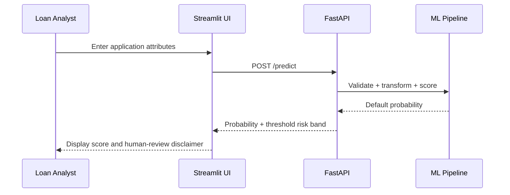

# Solution Architecture

## Logical layers

1. **Source**: SBA 7(a) FOIA extract and data dictionary.
2. **Ingestion**: Data Factory copies source into OneLake.
3. **Bronze**: immutable/raw landing Delta table; access tightly controlled due borrower identifiers.
4. **Silver**: deduplicated, typed, standardized data with quality checks and target construction.
5. **Gold**: completed 7(a) loans, FY2014–2019, approval-time features only.
6. **Warehouse**: dimensional model for portfolio reporting.
7. **ML**: chronological train/validation/test; LightGBM pipeline; threshold chosen on validation only.
8. **Serving**: model artifact loaded by FastAPI; Streamlit calls REST endpoint.
9. **RAG**: policy documents indexed separately; retrieval augmented answer references retrieved source passages.

## Prediction flow

## Data flow and governance

- Preserve raw data in Bronze; restrict it to authorized engineering roles.
- Remove direct borrower identifiers before Gold and model features.
- Retain source lineage and as-of dates.
- Do not use repayment outcomes, charge-off amounts, paid-in-full dates, or disbursement dates as approval-time features.
- Validate feature availability with the business before deployment.
- Warehouse reporting must use aggregated or appropriately access-controlled data.

## Model serving

The local reference uses a serialized scikit-learn Pipeline containing preprocessing and LightGBM. For a managed cloud deployment, evaluate Fabric model endpoints or Azure ML managed online endpoints based on current tenant capability, governance, latency, and cost. FastAPI is the portable API option shown here; it requires a separately deployed compute host.

## RAG boundary

RAG answers questions about policy/document content. The supervised ML model scores structured application attributes. The LLM must not generate or modify the numeric model score. Return document title/page/source metadata with retrieved passages and instruct the LLM to abstain when evidence is absent.
